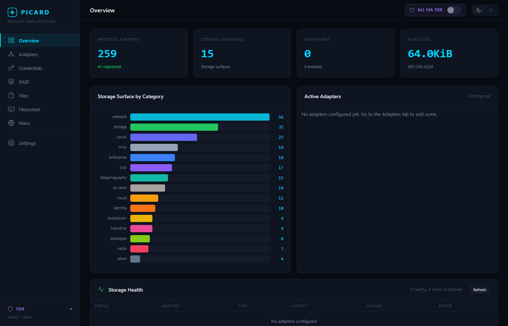
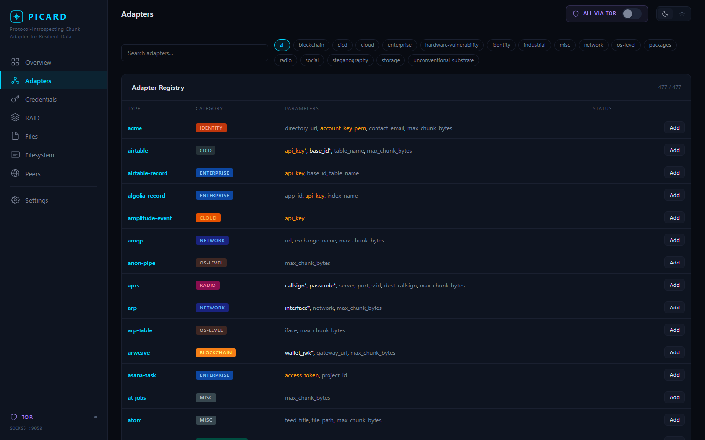

# PICARD

**Protocol-Introspecting Chunk Adapter for Resilient Data**

*For the self-taught, the unconventional, and anyone who was ever told to stay in their lane. Keep building, keep exploring.*

---

PICARD encrypts your data, slices it into chunks, and scatters those chunks across whatever protocol endpoints you configure: DNS TXT records, social media APIs, MQTT brokers, S3 buckets, Bluetooth advertisements, or all of the above at once. Pull it back and it reassembles. With multi-adapter scatter, no single endpoint holds enough ciphertext to reconstruct anything. No central server. No monthly storage fees. It mounts as a regular filesystem.

Not efficient. Protocol-agnostic.

> [!IMPORTANT]
> **Research project.** PICARD is a working computer science experiment, not a production storage system. Read the [research and legal notice](#research-and-legal-notice) before you proceed.

---

## New in 0.3.0: Hardware Vulnerability Storage

> [!WARNING]
> **Experimental: Run at your own risk.** These adapters use hardware vulnerabilities as storage primitives. Results are hardware-specific, non-deterministic across machines, and irreversible in the case of DRAM bit flips. Use only on hardware you own and control. Running against shared or cloud infrastructure is unauthorized access in most jurisdictions.

PICARD can now store chunks in **DRAM bit states and CPU cache residency** -- entirely outside the operating system's view.

| Adapter | What it does |
|---------|-------------|
| [`rowhammer`](picard/adapters/rowhammer_adapter.py) | Writes bits by hammering adjacent DRAM rows until charge leakage flips target bits. Reads by examining the victim row directly. Local, ephemeral, non-ECC DDR3/4. |
| [`halfdouble`](picard/adapters/halfdouble_adapter.py) | Two-hop variant. Near/far aggressor ratio bypasses DDR4 Target Row Refresh (TRR). Reaches hardware that classic rowhammer no longer affects. |
| [`throwhammer`](picard/adapters/throwhammer_adapter.py) | Hammers a **remote** host's DRAM over RDMA. The remote CPU is not involved at all -- the NIC DMA-reads directly to DRAM. Requires RDMA fabric. |
| [`cpu-cache`](picard/adapters/cpu_cache_adapter.py) | Stores bits in CPU L3 SRAM cache residency via Flush+Reload. Cross-process on the same host; cross-VM where page deduplication is active. |

All four are ephemeral (power cycle erases). See [docs/adapters.md](docs/adapters.md#tier-4-dram-and-cpu-hardware-vulnerability-substrates) for hardware requirements and threat model.

---

## How It Works

```
plaintext
  → AES-256-GCM encrypt     (Argon2id key, per-block salt + nonce)
  → PCHK chunk              (protocol-sized pieces)
  → scatter across adapters (DNS, Redis, Reddit, S3, MQTT, …)
  → sealed envelope          (HKDF sub-key, correlation tag per adapter)

retrieve
  ← fan out to all adapters
  ← collect, verify, assemble
  ← decrypt
```

Each block is independently encrypted with its own random salt and nonce. Chunks scatter round-robin or via RAID profiles. No adapter sees plaintext; no adapter sees enough ciphertext to reconstruct anything.

The local index (an AES-256-GCM encrypted SQLite database) maps paths to chunk locations. Lose the passphrase, lose the data.

<details>
<summary>The origin: a wall and some birds</summary>

*It was a cool Berlin morning. From my patio I stared at a plain stucco wall capped by red brick. A blur of wings caught my eye, a small bird veering into a drain hole near the roofline and vanishing. Another head appeared from a different hole, chirping. Five drain holes, five nests. The gutters were meant to move water, not host families, yet the birds had found shelter, cover, and easy access. I had never noticed because I had never bothered to look.*

*Our digital infrastructure carries more than it was designed to store. DNS TXT records accept arbitrary text within spec. MQTT retained messages persist data on the broker. ICMP echo packets carry a payload field. Social media APIs accept freeform structured text. Each of these protocols defines fields intended for metadata, discovery, or diagnostics. Those fields can carry bytes just as well as their designers' intended use cases.*

[Medium: A Wall, Some Birds, and The Internet Protocols We Aren't Looking At, Christopher Neitzert, May 2025](https://ckn46.medium.com/a-wall-some-birds-and-the-internet-protocols-we-arent-looking-at-0500922f3806?sharedUserId=ckn46)

</details>

---

## Web Dashboard

`picard web` opens a browser dashboard at [http://localhost:8471](http://localhost:8471).


*Storage surface by category, adapter health, and encryption details at a glance.*


*259 adapters browsable by category, with required parameters and one-click add.*

---

## Quickstart

```bash
pip install picard-store

export PICARD_PASSPHRASE="your-passphrase"   # or picard will prompt

picard init                                  # create picard.toml

# edit picard.toml to add your adapters, then:
picard put myfile.txt --as /docs/myfile.txt
picard get /docs/myfile.txt -o recovered.txt
picard ls
picard tree /
```

**From source:**

```bash
git clone https://github.com/neitzert/picard
cd picard
pip install -e ".[dev]"
python -m pytest --tb=short -q
```

---

## Configuration

```toml
# picard.toml

[general]
block_size = 65536

[[adapters]]
name       = "dns-primary"
type       = "dns"
enabled    = true
params     = { nameserver = "10.10.10.10", domain = "chunks.example.com" }

[[adapters]]
name       = "s3-backup"
type       = "s3"
enabled    = true
tor_proxy  = true              # route through Tor SOCKS5
params     = { bucket = "picard-chunks", prefix = "data/" }

[[adapters]]
name         = "reddit-stash"
type         = "reddit"
enabled      = true
browser_mode = "headed"        # api | headless | headed
params       = { subreddit = "u_myuser" }

[[raid]]
level    = "raid5"
adapters = ["dns-primary", "s3-backup", "filesystem"]

[scatter.paranoid]
raid_level   = "raid10"
min_adapters = 4
```

**Scatter profiles:** `quiet`, `resilient`, `speed`, `paranoid`

---

## CLI Reference

### Core operations

| Command | Description |
|---------|-------------|
| `picard put <file> --as <path>` | Store a file |
| `picard get <path> -o <file>` | Retrieve a file |
| `picard ls [path]` | List files |
| `picard rm <path>` | Delete |
| `picard cp / mv` | Copy / rename |
| `picard tree /` | Directory tree |
| `picard verify <path>` | Chunk integrity check |

### Filesystem

| Command | Description |
|---------|-------------|
| `picard mkdir / ln / head / tail / touch / log / stat / find` | Standard filesystem operations |
| `picard fsck` | Consistency check and repair |
| `picard mount <mountpoint>` | FUSE mount |
| `picard webdav` | WebDAV server (port 8471) |

### Infrastructure

| Command | Description |
|---------|-------------|
| `picard web` | Web dashboard (dark/light, drag-and-drop) |
| `picard scatter-report` | Storage surface map |
| `picard adapters / profiles` | List adapters and scatter profiles |
| `picard recover` | Journal crash recovery |
| `picard tor-check / tor-serve / tor-peer / tor-mount` | Tor operations |
| `picard init` | Create default `picard.toml` |

Most commands accept `--json` for machine-readable output.

---

## Filesystem Mount

`picard mount` exposes the virtual filesystem via FUSE. Standard shell tools work: `cp`, `ls`, `mv`, `rm`, `mkdir`, `cat`, `chmod`, `ln -s`, and `df` all behave as expected.

**Platform requirements:**

| Platform | Requirement |
|----------|-------------|
| Linux | `sudo apt install libfuse-dev` (or distro equivalent) |
| macOS | `brew install --cask macfuse` |
| Windows | [WinFSP](https://winfsp.dev/), or use `picard webdav` with Explorer's Map Network Drive |

**Known limitations:** no hard links, no file locking (`flock`/`fcntl`). Writes buffer the whole file in RAM and flush on close. Do not run SQLite WAL mode or Git object stores directly inside a mount.

`picard webdav` is the zero-driver alternative. Start it, point Explorer, Finder, or Nautilus at `http://localhost:8471`, and drag files in.

---

## MCP Server

PICARD exposes storage tools as an MCP server for Claude and other MCP-compatible agents:

```json
{
  "mcpServers": {
    "picard-store": {
      "command": "picard-mcp",
      "env": { "PICARD_PASSPHRASE": "your-passphrase" }
    }
  }
}
```

See [docs/mcp.md](docs/mcp.md) for available tools and setup details.

---

## Adapters

259 adapters in three tiers by authorization requirement. Full list: [docs/adapters.md](docs/adapters.md).

### Tier 1: Your own infrastructure

No third-party authorization required. These are the primary use case.

| Category | Examples |
|----------|---------|
| Local / database | Filesystem, Redis, PostgreSQL, S3, SQLite, etcd, CouchDB, Cassandra |
| Self-hosted services | WebDAV, Matrix (own homeserver), MQTT (own broker), XMPP, IRC |
| Mail / calendar | SMTP/IMAP, CalDAV, CardDAV |
| P2P / decentralized | IPFS, BitTorrent DHT, Nostr, Ethereum (own wallet), Tor hidden services |
| Steganography | Image LSB, audio WAV LSB, EXIF, XLSX hidden cells, ZIP comments |

### Tier 2: Third-party platforms

Require a valid account and API authorization on the relevant platform. Each adapter's source includes a platform-specific Terms of Service notice.

| Category | Examples |
|----------|---------|
| Social | Bluesky, Reddit, Discord, Telegram, Mastodon, Twitter/X, Tumblr |
| Media | YouTube, TikTok, Spotify, SoundCloud, Imgur, Flickr, Twitch |
| Professional | LinkedIn, GitHub, Slack, Notion, HuggingFace, Medium, Hacker News, Pinterest, Steam |
| Package registries | PyPI, npm, crates.io, RubyGems |

> **Note on package registry adapters (PyPI, npm, crates.io, RubyGems):** these are research demonstrations. Some contain intentional friction in their write paths that prevents out-of-the-box use against public registries. If an adapter silently succeeds but data does not appear, or fails with an unexpected protocol error, read the source. The fix in each case is a small, deliberate change. This is by design.

### Tier 3: RF spectrum and regulated hardware

Authorization requirements vary by jurisdiction, frequency, and device type. Read the regulatory notice in each adapter's source before use.

| Category | Examples |
|----------|---------|
| Radio | LoRa/LoRaWAN, SDR (receive-only without license), WiFi beacons, AX.25/amateur radio |
| Short-range | Bluetooth LE, NFC, ZigBee |
| Hardware buses | CAN bus (own hardware only), USB-HID, serial |

Each adapter implements `write_chunk()` and `read_chunk()`. It does not manage encryption or track manifests. It stores bytes and retrieves them.

---

## Cryptographic Posture

All symmetric: Argon2id key derivation, HKDF-SHA256 sub-keys, AES-256-GCM authenticated encryption, HMAC-SHA256 for transport auth and correlation tags. No public-key cryptography in the storage path.

AES-256 provides 128-bit security against Grover's algorithm on a fault-tolerant quantum computer, matching the security target of NIST post-quantum standards. The ciphertext format carries a version byte so the cipher suite can be swapped without re-encrypting stored data.

---

## Honest Downsides

PICARD is not magic, perhaps poetic. It is certainly not efficient, will not be fast, and offers zero guarantees.

- **Reads are slow.** Writes may partially fail.
- **Chunk loss means data loss.** No global index, no recovery path if too many chunks go missing.
- **Best for small, critical datasets** (a few MB to low GB). Larger files compound both retrieval slowness and chunk-loss risk.
- **Adapters age.** As protocols evolve or get patched, adapters may need updates.
- **Invisible to standard monitoring.** Chunks are opaque to conventional storage tools unless you know where to look.

If you need uptime guarantees, deterministic performance, or expect everything to work without tinkering, this is probably not for you.

---

## Research and Legal Notice

PICARD is an experimental computer science research project exploring protocol-agnostic storage abstractions. It is published for educational, experimental, and interoperability research purposes under the MIT license.

Users are solely responsible for ensuring their use complies with applicable law and the terms of service of any third-party platform or network accessed through a PICARD adapter. **PICARD does not authorize access to systems, accounts, or infrastructure the user does not own or have explicit permission to use.**

<details>
<summary>Full dual-use notice and terms</summary>

Like most security and systems research, PICARD has dual-use capabilities: the same techniques that enable resilient personal storage can, in principle, be misused. Publishing this work does not endorse or encourage misuse; it serves the community's interest in understanding these surfaces so they can be studied, defended against, and properly accounted for.

**Acceptable use.** Any use of PICARD to violate applicable law (including but not limited to computer fraud and abuse statutes, electronic communications privacy law, or the Terms of Service of any platform) immediately and irrevocably voids any claim to acceptable use under this project. If you use PICARD to break the law or violate platform Terms of Service, you are entirely on your own. The authors provide no support, defense, or indemnification for unlawful or unauthorized use. This is not a disclaimer of liability; it is a boundary.

Each adapter's source includes a platform-specific notice. Read it before you use the adapter.

The full terms are in [TERMS.md](TERMS.md). On first run, `picard` will prompt you to accept them. Pass `--accept-terms` to accept permanently, or set `PICARD_ACCEPT_TERMS=1` for scripted use.

By using PICARD you accept full responsibility for your actions and their consequences. You agree to indemnify, defend, and hold harmless the authors, contributors, and maintainers of PICARD from and against any and all claims, liabilities, damages, losses, costs, and expenses arising out of or related to your use or misuse of this software.

**On ethics.** Ethics in this context is the mortar between the bricks, not an optional coat of paint. The premise of this research is not that protocol fields are available for any purpose; it is that understanding them as storage substrates is a useful contribution to the literature, and that the community benefits from knowing these surfaces exist. Exploration is fine, even necessary, but it comes with the obligation to think through collateral damage, disclose what you find, and leave breadcrumbs for defenders to address if they choose. Running PICARD responsibly means using it on infrastructure you control, resisting the urge to turn research findings into personal leverage, and being ready to stop when the experiment tips from curiosity into something else.

</details>

---

## Test Coverage and Contributing

The core cryptographic path, orchestrator, RAID layer, index, and scatter profiles are fully tested (4,236 tests). Many protocol adapters have unit tests with mocked transports; a significant portion has not been exercised against live infrastructure, particularly the browser-automation paths and adapters for exotic protocols (RF, hardware buses, satellite, raw sockets).

**Pull requests are welcomed**, especially for:

- Integration tests for adapter browser paths (see `tests/integration/`)
- Tests or fixes for untested or partially-tested adapters
- Real-world validation of exotic protocol adapters
- New adapters (include at least a mocked unit test covering `write_chunk()`, `read_chunk()`, and `delete_chunk()`)
- Documentation improvements and usage examples

Open an issue for bugs or questions.

---

## Documentation

| Doc | Contents |
|-----|---------|
| [Architecture](docs/architecture.md) | Data flow, key hierarchy, RAID, scatter profiles |
| [Adapters](docs/adapters.md) | Full adapter list, writing custom adapters |
| [CLI Reference](docs/cli.md) | All commands with examples |
| [MCP Server](docs/mcp.md) | Agent storage interface, setup, available tools |
| [FUSE Mount](docs/fuse.md) | Mounting, performance, platform notes |
| [WebDAV](docs/webdav.md) | Network drive mounting, native OS drag-and-drop |
| [Tor](docs/tor.md) | Anonymity, hidden services, .onion peers |
| [Network](docs/network.md) | Transport layer, peer discovery, remote adapters |
| [Identifying PICARD in the Wild](docs/identifying-picard-in-the-wild.md) | Observability, confidentiality, and attribution across 18 platforms |

---

## License

MIT. Copyright 2024–2026 Christopher Neitzert.

*In the wild, anything left open long enough becomes habitat.*
